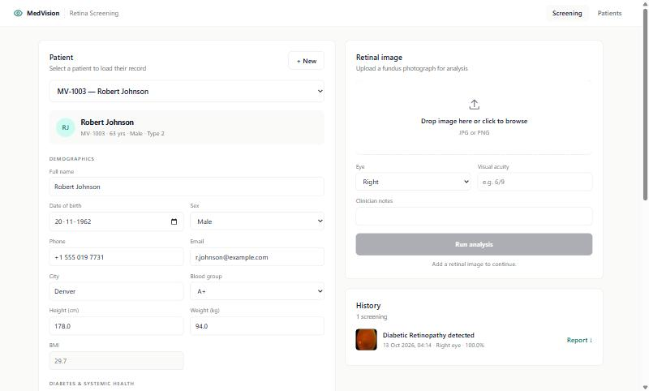
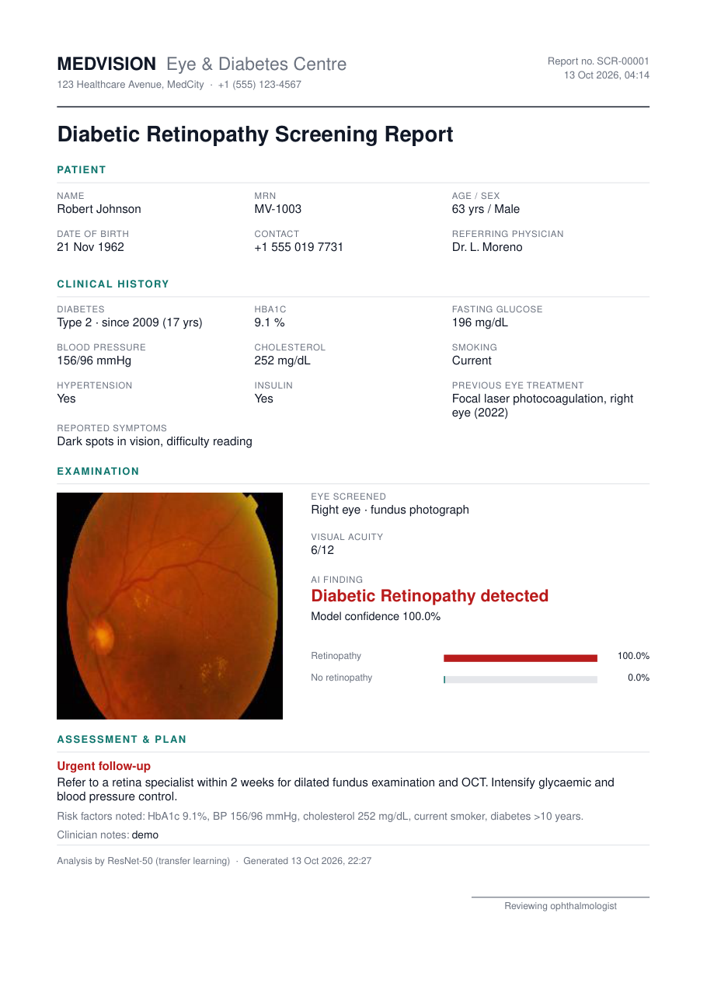

# RetinaDR

**AI-powered diabetic retinopathy screening: patient records, retinal image upload, instant ResNet-50 diagnosis and a downloadable PDF report.**

[](LICENSE)
[](https://huggingface.co/spaces/PratyushZen/dr-detection)


Diabetic retinopathy (DR) is a leading cause of preventable blindness. It has no symptoms in its early stages,
and rural and low-income patients often cannot reach an ophthalmologist. RetinaDR lets a health worker register
a patient, upload a retinal fundus photograph and get an instant DR / No DR result with a risk-based follow-up
plan and a printable report.

> Built for the Hack for Social Cause (HSC) hackathon, theme **Healthcare & Wellbeing**
> (UN SDG 3, with SDG 9 and SDG 10).

**Live model:** <https://huggingface.co/spaces/PratyushZen/dr-detection>


## Features

- **Patient records in PostgreSQL**: demographics, diabetes history, HbA1c, blood pressure, cholesterol, smoking,
  medications, allergies, eye history and symptoms. Pick a patient from a dropdown and every field is filled in
  automatically from the database; edits are saved back.
- **Retinal image analysis**: drag and drop a fundus image. The backend sends it to the ResNet-50 model on
  Hugging Face and stores the verdict, confidence and both class probabilities.
- **Follow-up plan**: the AI result is combined with the patient's risk factors to give an urgency level
  (Urgent, Priority, Routine) and a recommended follow-up.
- **PDF report download**: a one-page report with patient details, clinical history, the retinal image, the AI
  finding and the plan ([sample](docs/sample-report.pdf)).
- **Screening history** per patient, so earlier results and reports can be reopened.

<p align="center">
  
  
</p>

## Tech stack

| Layer | Technology |
|---|---|
| Database | **PostgreSQL** (`patients`, `screenings`) |
| Backend | **Node.js** + **Express**, `pg`, `multer`, `pdfkit` |
| Frontend | **React 18** + Vite |
| AI model | **PyTorch / torchvision ResNet-50**, served with Gradio on **Hugging Face Spaces** |

## Repository structure

```
retinaDR/
├── client/               React (Vite) frontend
├── server/               Express API, PostgreSQL schema, seed data, tests
│   ├── src/              index.js (routes), model.js (HF client), followup.js, report.js, schema.sql
│   ├── scripts/          init-db.js, seed-data.js, model-smoke-test.js
│   └── test/             unit tests
├── huggingface-space/    Code deployed to the Hugging Face Space (app.py, requirements.txt)
├── sample-data/          Two sample fundus images + expected results
├── docs/                 Architecture diagram, technical design document, figures, sample report
├── LICENSE               MIT
└── package.json          Root scripts: setup, dev, test
```

## The AI model

| | |
|---|---|
| Task | Binary classification of a retinal fundus image: **DR** vs **No DR** |
| Architecture | ResNet-50, ImageNet-pretrained, final layer replaced with a 2-neuron fully connected layer |
| Training | Transfer learning with all layers fine-tuned. Cross-entropy loss, Adam optimiser, learning rate 0.001, batch size 32, 5 epochs |
| Data | Kaggle retinal fundus images with two classes (DR, No_DR) split into train, validation and test sets. Severity grades were merged into DR / No DR |
| Preprocessing | Resize to 224 x 224, convert to tensor, ImageNet normalisation (mean 0.485, 0.456, 0.406; std 0.229, 0.224, 0.225). No extra augmentation |
| Weights | `resnet50_trained.pth` (94 MB), stored in the [Hugging Face Space](https://huggingface.co/spaces/PratyushZen/dr-detection/tree/main) and not in this repo |
| Serving | Gradio app on Hugging Face Spaces (`huggingface-space/app.py`). The Express backend calls the Gradio HTTP API |

**Validation results** (531 images: 245 DR, 286 No DR), overall accuracy **95.48%**:

| Class | Precision | Recall | F1-score | Support |
|---|---|---|---|---|
| DR | 0.9702 | 0.9306 | 0.9500 | 245 |
| No DR | 0.9426 | 0.9755 | 0.9588 | 286 |
| Macro average | 0.9564 | 0.9531 | 0.9544 | 531 |


The confusion matrices for the validation and test sets and the training curves are in the
[technical design document](docs/technical-design.md#7-model). The training notebook ran on Google Colab.

The research behind the model is described in our IEEE paper *"Deep Learning-Based Diabetic Retinopathy Detection
Using ResNet50"* (ICCCIoT-2026).

## Setup

### Prerequisites

- **Node.js 18 or newer** (tested on 22)
- **PostgreSQL 14 or newer** (tested on 17), running locally, with a user that can create databases
- Internet access: the app calls the model on Hugging Face

### 1. Clone and configure

```bash
git clone https://github.com/PratyushSowrirajan/retinaDR.git
cd retinaDR
cp server/.env.example server/.env      # on Windows: copy server\.env.example server\.env
```

Open `server/.env` and set your PostgreSQL password (see the table below).

### 2. Install, create the database and seed demo patients

```bash
npm run setup
```

This installs the root, server and client dependencies, then creates the `retina_dr` database, applies
`server/src/schema.sql` and inserts 6 fictional demo patients. It is safe to run again.

### 3. Run

```bash
npm run dev
```

- Web app: <http://localhost:5173>
- API: <http://localhost:5000> (health check at `/api/health`)

### Environment variables

Set these in `server/.env` (template: `server/.env.example`).

| Variable | Default | Description |
|---|---|---|
| `PORT` | `5000` | Port the Express API listens on |
| `PGHOST` | `localhost` | PostgreSQL host |
| `PGPORT` | `5432` | PostgreSQL port |
| `PGUSER` | `postgres` | PostgreSQL user |
| `PGPASSWORD` | none | PostgreSQL password. **Required** |
| `PGDATABASE` | `retina_dr` | Database name. Created automatically by `npm run db:init` |
| `HF_SPACE_URL` | `https://pratyushzen-dr-detection.hf.space` | Hugging Face Space that serves the model |

The frontend needs no configuration. Vite proxies `/api` and `/uploads` to `http://localhost:5000`.

### Run the model locally (optional)

The app uses the hosted model by default. To host your own copy:

```bash
cd huggingface-space
pip install -r requirements.txt
# download the weights next to app.py
curl -L -o resnet50_trained.pth https://huggingface.co/spaces/PratyushZen/dr-detection/resolve/main/resnet50_trained.pth
python app.py
```

Then set `HF_SPACE_URL=http://localhost:7860` in `server/.env`. The Space is pinned to Python 3.10 in its
README header; `requirements.txt` pins the library versions that work together.

## Tests

```bash
npm test                      # unit tests for the follow-up rules (no network needed)
cd server && npm run test:model   # sends the sample images to the live model and checks the verdicts
```

The sample images and their expected results are in [`sample-data/`](sample-data).

## API reference

| Method | Endpoint | Description |
|---|---|---|
| `GET` | `/api/health` | Liveness check |
| `GET` | `/api/patients` | List patients with age and last screening result |
| `GET` | `/api/patients/:id` | One patient |
| `POST` | `/api/patients` | Register a patient (MRN is generated). Name, date of birth and sex required |
| `PUT` | `/api/patients/:id` | Update a patient |
| `DELETE` | `/api/patients/:id` | Delete a patient and their screenings |
| `GET` | `/api/patients/:id/screenings` | Screening history for a patient |
| `POST` | `/api/screenings` | Multipart form: `patient_id`, `image`, `eye`, `visual_acuity`, `notes`. Runs the model and stores the result |
| `GET` | `/api/screenings/:id/report` | Download the PDF report |

## Documentation

- [Technical design document](docs/technical-design.md): architecture, data model, API, model details, sequence flow
- [Architecture diagram](docs/architecture.png) ([SVG](docs/architecture.svg), source in `docs/diagrams/`)
- [Sample PDF report](docs/sample-report.pdf)

## Roadmap

- Multi-grade severity classification (No DR to Proliferative DR)
- Explainability heatmaps (Grad-CAM) so clinicians can see what drove a prediction
- Low-cost capture kit (Raspberry Pi camera with a macro lens) and on-device inference for offline use
- User accounts, audit logging and encryption of stored patient data

## License

Released under the [MIT License](LICENSE). The fundus dataset used for training is subject to its own terms on
Kaggle and is not redistributed here.

## Team

Pratyush S, Sanjaikumar A and Selvamuthukumaran R, Sri Sairam Engineering College.
Supervisor: Dr. S. Hemavathi. Guide: Dr. R. Uma.
