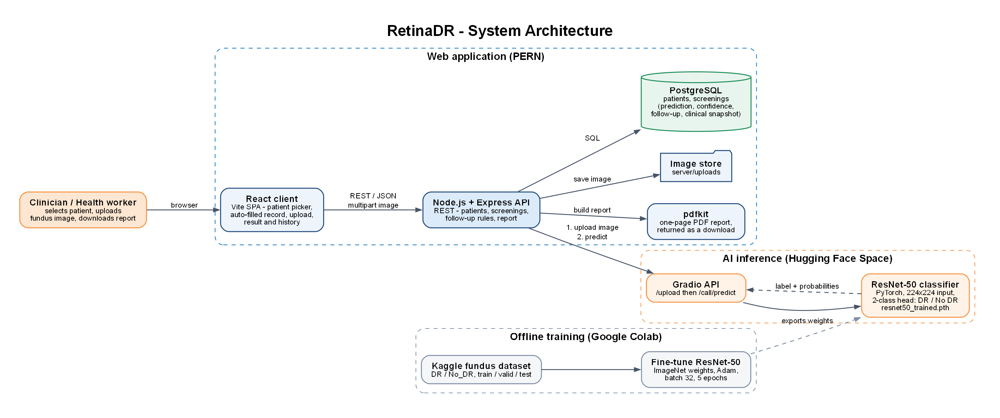
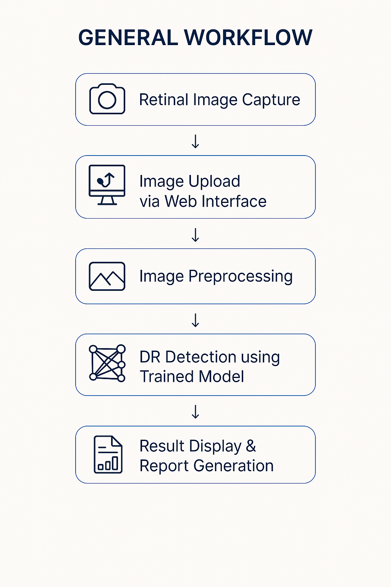
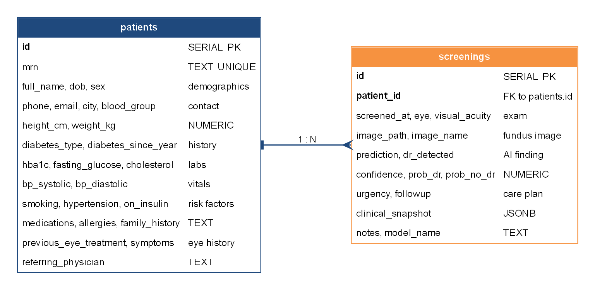
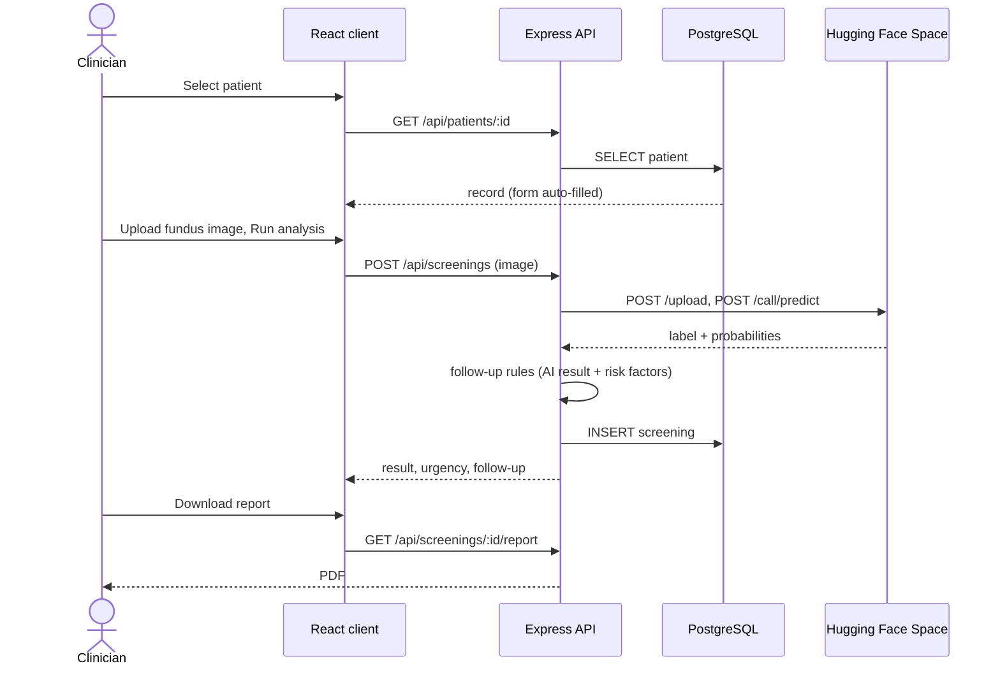
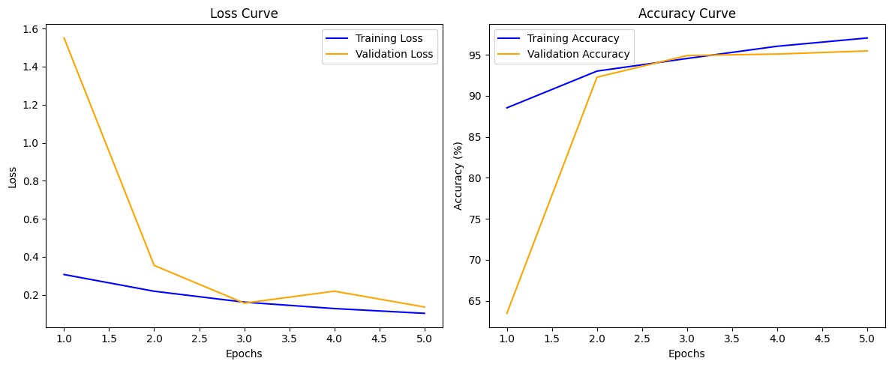
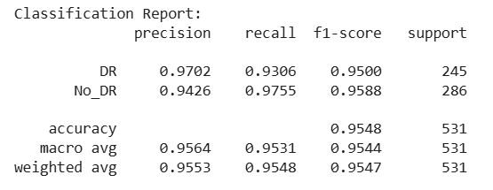
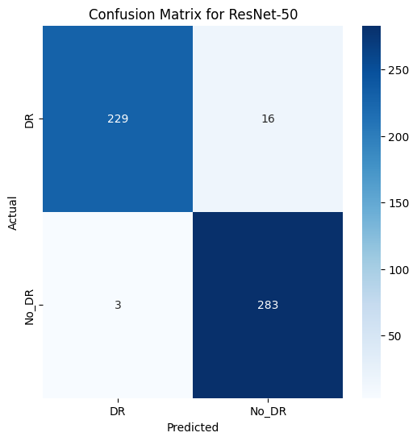
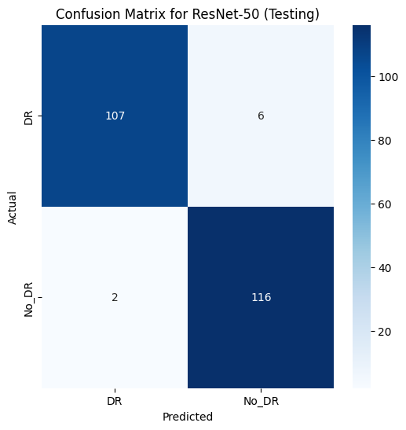

# RetinaDR: Technical Design Document

## 1. Overview

RetinaDR screens retinal fundus photographs for diabetic retinopathy (DR). A clinician or health worker registers
a patient, uploads a fundus image, and receives an AI verdict (DR / No DR) with a follow-up plan and a PDF report.
Every patient, image and result is stored in PostgreSQL so a patient's history can be reopened later.

**Goals**

- Make first-level DR screening possible without a specialist on site
- Keep a complete record per patient: clinical history, images, AI results and reports
- Keep the model separate from the app so it can be improved or moved without touching the backend

**Out of scope (current version):** multi-grade severity, user accounts, DICOM support, on-device inference.

## 2. Architecture

The system has three parts:

| Part | Responsibility | Technology |
|---|---|---|
| **Web application** | Patient records, upload, results, history, PDF reports | React + Vite, Node.js + Express, PostgreSQL |
| **AI inference** | Classify a fundus image as DR / No DR | PyTorch ResNet-50 behind a Gradio API on Hugging Face Spaces |
| **Offline training** | Fine-tune ResNet-50 on labelled fundus images and export weights | Google Colab, PyTorch |

The browser only talks to the Express API. Express stores data in PostgreSQL, keeps uploaded images on disk and
calls the Hugging Face Space for predictions. The report is generated by Express with `pdfkit`.

## 3. Components

### 3.1 React client (`client/`)

| File | Purpose |
|---|---|
| `App.jsx` | Top bar, tab switch (Screening / Patients), loads the patient list |
| `Screening.jsx` | Patient dropdown, auto-filled editable record, image upload, result card, history |
| `Patients.jsx` | Searchable patient table and the "New patient" dialog |
| `PatientForm.jsx` | Shared form: demographics, diabetes and systemic health, eye history. Calculates BMI |
| `api.js` | Thin `fetch` wrapper for the REST API |

When a patient is selected, the client fetches the full record and fills every field. Changes mark the form
as dirty and show a save bar; running an analysis with unsaved changes saves them first.

### 3.2 Express API (`server/src/`)

| File | Purpose |
|---|---|
| `index.js` | Routes, file upload (`multer`), request validation |
| `db.js` | PostgreSQL connection pool |
| `model.js` | Client for the Hugging Face Gradio API with retries |
| `followup.js` | Risk factors and the urgency / follow-up rules |
| `report.js` | One-page PDF report |
| `schema.sql` | Database schema |

### 3.3 Hugging Face Space (`huggingface-space/`)

`app.py` loads `resnet50_trained.pth` into a torchvision ResNet-50 with a 2-class head, applies the same
preprocessing used in training and exposes a Gradio interface. The Space is pinned to Python 3.10 and fixed
library versions in `requirements.txt`, because Gradio 4.44 does not work with the newest `huggingface_hub`,
`fastapi` and `starlette`.

## 4. Data model

- `patients`: one row per person. Medical record number (`MV-1001`, ...) is generated on creation.
- `screenings`: one row per analysed image, linked by `patient_id` (cascade delete).
  It stores the verdict, confidence, both class probabilities, urgency, follow-up text, the image path and a
  `clinical_snapshot` (HbA1c, blood pressure, cholesterol, glucose, smoking at the time of screening) so a
  report stays accurate even if the patient record changes later.

Full DDL: [`server/src/schema.sql`](../server/src/schema.sql).

## 5. API

| Method | Endpoint | Description |
|---|---|---|
| `GET` | `/api/health` | Liveness check |
| `GET` | `/api/patients` | List patients, each with `age`, `last_screening` and `screening_count` |
| `GET` | `/api/patients/:id` | One patient |
| `POST` | `/api/patients` | Create. Requires `full_name`, `dob`, `sex` |
| `PUT` | `/api/patients/:id` | Update any patient fields |
| `DELETE` | `/api/patients/:id` | Delete patient and screenings |
| `GET` | `/api/patients/:id/screenings` | History, newest first |
| `POST` | `/api/screenings` | `multipart/form-data`: `patient_id`, `image`, `eye` (Right/Left), `visual_acuity`, `notes` |
| `GET` | `/api/screenings/:id/report` | PDF download |

## 6. Screening flow

If the Space is asleep, the first request can take a minute; `model.js` retries up to four times before it
reports that the model service is unavailable.

## 7. Model

### 7.1 Training

| Item | Value |
|---|---|
| Base network | ResNet-50 pretrained on ImageNet |
| Change | Final fully connected layer replaced with 2 outputs (DR, No DR) |
| Fine-tuning | All layers trainable |
| Loss / optimiser | Cross-entropy, Adam |
| Learning rate / batch / epochs | 0.001 / 32 / 5 |
| Input | 224 x 224 RGB, ImageNet mean and standard deviation, no extra augmentation |
| Labels | Original severity grades merged into DR (any grade above 0) and No DR |
| Environment | Google Colab, PyTorch |

Class order is fixed: output index 0 is **DR**, index 1 is **No DR**.

### 7.2 Evaluation

Validation set: 531 images (245 DR, 286 No DR). Accuracy **95.48%**.

| Class | Precision | Recall | F1-score | Support |
|---|---|---|---|---|
| DR | 0.9702 | 0.9306 | 0.9500 | 245 |
| No DR | 0.9426 | 0.9755 | 0.9588 | 286 |

| Validation | Test |
|---|---|
|  |  |

### 7.3 Inference contract

The backend calls the Gradio API:

1. `POST {HF_SPACE_URL}/upload` with the image, which returns a server-side file path
2. `POST {HF_SPACE_URL}/call/predict` with `{"data": [{"path": ..., "meta": {"_type": "gradio.FileData"}}]}`,
   which returns an `event_id`
3. `GET {HF_SPACE_URL}/call/predict/{event_id}`, a server-sent event whose `complete` payload contains the
   label and a confidence for each class

The backend marks DR as detected when the DR probability is at least the No DR probability.

## 8. Follow-up rules

Risk factors counted from the patient record: HbA1c at least 8%, blood pressure at least 140/90 mmHg,
total cholesterol at least 240 mg/dL, current smoker, diabetes for more than 10 years.

| AI result | Risk factors | Urgency | Follow-up |
|---|---|---|---|
| DR detected | 2 or more | **Urgent** | Retina specialist within 2 weeks, fundus exam and OCT, tighten glucose and BP control |
| DR detected | fewer than 2 | **Priority** | Ophthalmologist within 4 weeks |
| No DR | 2 or more | Routine | Re-screen in 6 months |
| No DR | fewer than 2 | Routine | Annual screening |

Unit tests: [`server/test/followup.test.js`](../server/test/followup.test.js).

## 9. PDF report

Generated on demand by `report.js` (A4, one page): header and report number, patient block, clinical history,
the retinal image, the AI finding with probability bars, the urgency and follow-up plan, clinician notes,
and a signature line. Example: [sample-report.pdf](sample-report.pdf).

## 10. Deployment

| Component | Where | Notes |
|---|---|---|
| Model | Hugging Face Space `PratyushZen/dr-detection` | Python 3.10, weights tracked with Git LFS |
| Database | Any PostgreSQL 14+ | `npm run db:init` creates the database and seeds demo patients |
| API + client | Local Node.js (`npm run dev`) | Vite dev server proxies `/api` and `/uploads` to the API |

Configuration is by environment variables in `server/.env`; see the main README for the full table.

## 11. Testing

| Test | Command | Covers |
|---|---|---|
| Unit | `npm test` | Risk factor detection and all four follow-up outcomes |
| Model smoke test | `cd server && npm run test:model` | Sends the two images in `sample-data/` to the live model and checks the verdicts |

## 12. Security and privacy notes

This version is a working prototype for demonstration:

- There is no login; anyone who can reach the API can read patient data
- Uploaded images are stored unencrypted on the API server's disk
- The demo patients are fictional

A production deployment would add authentication and roles, encrypted storage, audit logging, HTTPS and
consent handling before any real patient data is used.

## 13. Limitations and future work

- Binary output only (DR / No DR); severity grading is planned
- Accuracy depends on image quality; an upload-time quality check is planned
- Needs external validation on images from other cameras and populations
- Explainability heatmaps (Grad-CAM) and an offline edge-device mode are planned
